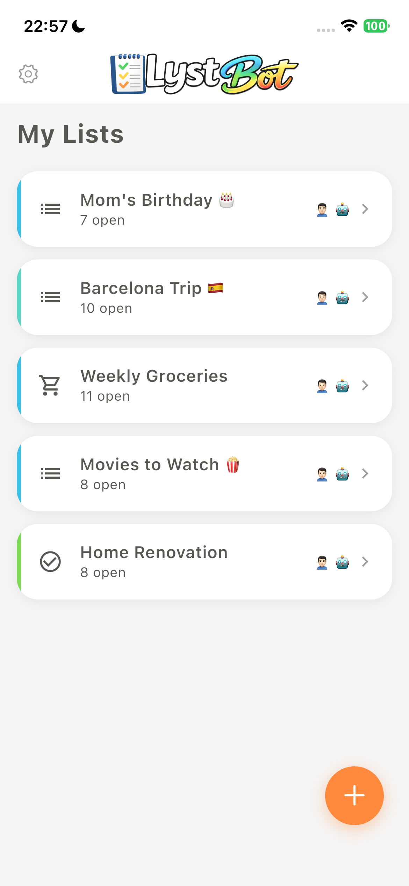
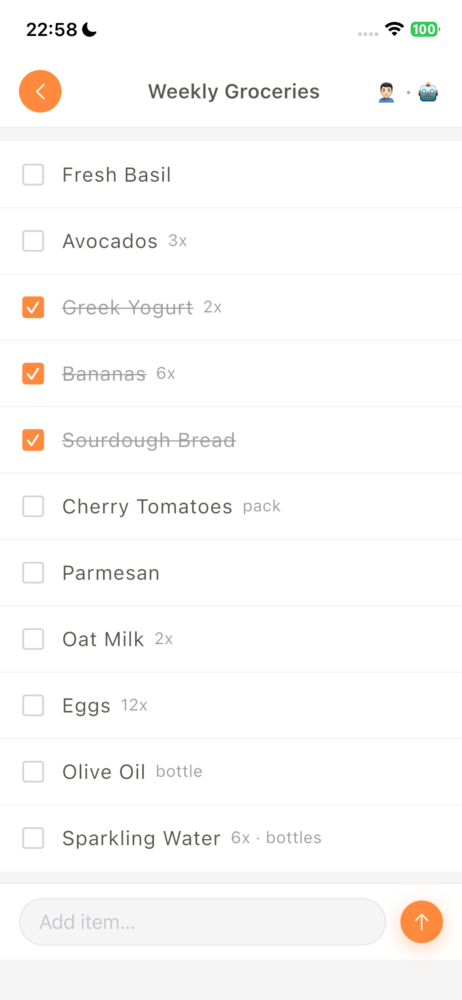
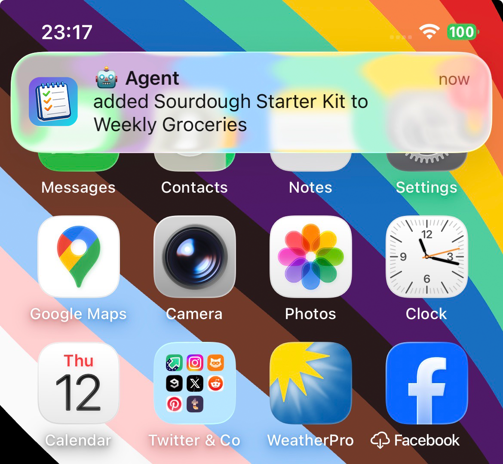

<p align="center">
  
</p>

<h3 align="center">Smart lists and reminders that your AI can actually use.</h3>

<p align="center">
  <a href="LICENSE"></a>
  <a href="https://www.npmjs.com/package/lystbot"></a>
  <a href="https://lystbot.com/api/v1/health"></a>
</p>

<p align="center">
  <strong>LystBot is not another AI list app.</strong> There's no built-in AI, no chatbot and no "AI-powered suggestions".<br />
  Instead, LystBot gives <em>your</em> AI (a personal agent on OpenClaw, a Custom GPT, Claude) direct access to your lists and reminders.<br />
  Your AI writes to the lists. You see the result in the app on your phone.
</p>

---

## 🚀 Getting started

### 1. Get the app

<p align="center">
  <a href="https://apps.apple.com/app/lystbot/id6742044832"></a>
  &nbsp;&nbsp;
  <a href="https://play.google.com/store/apps/details?id=io.touraround.lystbot"></a>
</p>

Open the app, create your first list, and grab your API key from **Settings → AI Agents**.

### 2. Connect your AI agent

The agent setup page has step-by-step instructions:

👉 **[lystbot.com/agents](https://lystbot.com/agents)**

There are three ways to connect:

| Method | Best for | Setup time |
|--------|----------|------------|
| CLI | OpenClaw, Grok Bot, personal agents, scripts, automation | 1 min |
| MCP server | Claude Desktop, Claude Code, Codex, Cursor, Devin Desktop | 2 min |
| REST API | ChatGPT Actions, Copilot Studio, custom agents, Home Assistant | 5 min |

### 3. That's it

```bash
npx lystbot login YOUR_API_KEY
npx lystbot add "Groceries" "Oat milk, Bananas, Coffee"
```

The items show up in the app right away.

---

## 🧠 How it works

Most "AI list apps" put a chatbot inside the app. LystBot does the opposite: you keep using the AI you already have, and it controls LystBot from the outside.

```
You → talk to your AI → AI calls LystBot API → your phone updates instantly
```

There's no new AI to learn and no prompting inside the app. Connect your existing AI and let it manage groceries, packing lists, todos and reminders.

- "Add eggs to my shopping list" works from any AI you already use.
- Your phone is the display. Your AI writes, you see the change.
- The app is for humans, the API is for agents.
- Changes sync in real time: your AI adds milk, your partner sees it immediately.

---

## ✨ Features

- **Lists**: create, organize and share lists.
- **Sharing**: invite others with a share code and edit the same list together.
- **Platforms**: iOS and Android apps, plus CLI and API access.
- **Favorites**: quick access to items you add often.
- **Categories**: split a list into sections and move items between them. Items without a category go to Other.
- **Attachments**: add images and links to items from the app, the CLI or an MCP client.
- **Reminders**: your AI can create, update, disable and delete one-time or recurring reminders.
- **Push notifications**: get notified when your AI or your family changes a list.
- **REST API**: any AI agent can read and change lists, categories and reminders.

<p align="center">
  
  &nbsp;&nbsp;
  
  &nbsp;&nbsp;
  
</p>

---

## 🤖 Agent integrations

LystBot works with any AI that can make HTTP requests. Here's how to connect yours:

### Personal agents & autonomous frameworks

| Agent | Provider | Integration |
|-------|----------|-------------|
| OpenClaw | OpenClaw | CLI (`npx lystbot`) or MCP Server |
| Hermes Agent | Nous Research | MCP Server |
| Grok Bot | xAI | CLI on the Bot's cloud computer |
| Devin | Cognition | CLI or REST API |
| Aider | Open Source | CLI |
| OpenCode | Open Source | CLI or MCP Server |
| AutoGPT | Open Source | REST API |
| CrewAI | Open Source | REST API or MCP Server |
| Manus AI | Manus | REST API |

### Coding agents & IDEs

| Agent | Provider | Integration |
|-------|----------|-------------|
| Claude Desktop | Anthropic | MCP Server ([setup below](#claude-desktop)) |
| Claude Code | Anthropic | MCP Server ([setup below](#claude-code)) |
| Codex | OpenAI | MCP Server ([setup below](#codex--grok-build)) |
| Cursor | Anysphere | MCP Server |
| Devin Desktop (formerly Windsurf) | Cognition | MCP Server |
| GitHub Copilot | GitHub | MCP Server |
| Grok Build | xAI | MCP Server ([setup below](#codex--grok-build)) |
| Antigravity | Google | MCP Server |
| Cline | Open Source | MCP Server |

### Voice assistants & chat AI

| Agent | Provider | Integration |
|-------|----------|-------------|
| ChatGPT | OpenAI | Custom GPT with OpenAPI Actions |
| Google Gemini | Google | Gemini API function calling with the REST API |
| Microsoft Copilot | Microsoft | Copilot Studio agent with a REST API tool (OpenAPI) |
| Grok | xAI | xAI API function calling with the REST API |
| Siri / Apple Intelligence | Apple | Apple Shortcuts with REST API |
| Amazon Alexa | Amazon | [LystBot Alexa skill](https://www.amazon.de/dp/B0HGRK2B5H) |

> Don't see your agent? If it can call an API, it can use LystBot. Check the [API docs](./docs/api/).

---

## 💻 CLI

The LystBot CLI manages your lists from the terminal. It's built for AI agents like OpenClaw that work best with command-line tools, and for anyone who likes to script things.

### Install & login

```bash
npm install -g lystbot
lystbot login <YOUR_API_KEY>
```

Without a global install, prefix every command with `npx`, for example `npx lystbot lists`.

### Commands

```bash
# Lists
lystbot lists                              # Show all lists
lystbot show "Groceries"                   # Show a list with items
lystbot create "Packing List" --emoji "🧳" # Create a new list
lystbot delete "Old List" --force          # Delete a list

# Items
lystbot add "Groceries" "Milk, Eggs, Bread"  # Add items (comma-separated)
lystbot add "Groceries" "250g Mehl; 3x Milch; 3 Bananen" # Parse unit and count prefixes
lystbot add "Groceries" "Mehl" --quantity 2 --unit "500g" # Explicit fields
lystbot check "Groceries" "Milk"             # Check off an item
lystbot uncheck "Groceries" "Milk"           # Uncheck an item
lystbot remove "Groceries" "Milk"            # Remove an item

# Attachments
lystbot attach-image "Groceries" "Milk" ./photo.jpg     # Attach a local image
lystbot attach-url "Groceries" "Milk" "https://example.com" "Recipe"  # Attach a link
lystbot attachments "Groceries" "Milk"                  # Show attachments
lystbot detach <attachment-id>                          # Delete an attachment

# Categories
lystbot categories "Groceries"                 # List categories (incl. Other)
lystbot category add "Groceries" "Fruits"      # Create a category
lystbot add "Groceries" "Bananas" --category "Fruits"   # Add into a category
lystbot move "Groceries" "Bananas" --category other      # Move to Other/uncategorized

# Reminders
lystbot reminders                                      # Show all reminders
lystbot reminder <id>                                  # Show one reminder
lystbot remind "Take vitamins" --at "2026-05-08 09:00" --timezone "Europe/Berlin"
lystbot reminder-update <id> --title "Take supplements"
lystbot reminder-update <id> --at "2026-05-09 09:00" --enabled
lystbot reminder-update <id> --disabled
lystbot reminder-delete <id> --yes

# Sharing
lystbot share "Groceries"                  # Generate a share code
lystbot join ABC123                        # Join a shared list

# Agent identity
lystbot profile --name "TARS" --emoji "🤖" # Set your bot's display name
```

> Full reference: [CLI docs](./docs/cli/)

---

## 🔌 MCP Server

The CLI includes an [MCP](https://modelcontextprotocol.io) server. It runs locally over stdio, so it works with Claude Desktop, Claude Code, Codex, Cursor, Devin Desktop, Grok Build, Antigravity, Cline and any other MCP client that can start a local server.

Log in first. Every setup below needs this:

```bash
npx lystbot login <YOUR_API_KEY>
```

### Claude Desktop

Add this to your config file:

**macOS:** `~/Library/Application Support/Claude/claude_desktop_config.json`
**Windows:** `%APPDATA%\Claude\claude_desktop_config.json`

```json
{
  "mcpServers": {
    "lystbot": {
      "command": "npx",
      "args": ["lystbot", "mcp"]
    }
  }
}
```

Then restart Claude Desktop.

### Claude Code

```bash
claude mcp add lystbot -- npx lystbot mcp
```

Claude Code can now manage your lists.

### Codex / Grok Build

```bash
codex mcp add lystbot -- npx lystbot mcp   # Codex
grok mcp add lystbot -- npx lystbot mcp    # Grok Build
```

<a id="cursor--windsurf--cline"></a>
### Cursor / Devin Desktop / Antigravity / Cline

Add the same config to the tool's MCP settings. For Cursor that's `.cursor/mcp.json`, for Devin Desktop `~/.config/devin/mcp_config.json` and for Antigravity `~/.gemini/config/mcp_config.json`. Cline has its own MCP settings screen.

```json
{
  "mcpServers": {
    "lystbot": {
      "command": "npx",
      "args": ["lystbot", "mcp"]
    }
  }
}
```

### Available tools

| Tool | Description |
|------|-------------|
| `list_lists` | Get all your lists |
| `get_list` | Get a specific list with items |
| `create_list` | Create a new list |
| `delete_list` | Delete a list |
| `add_items` | Add natural strings or structured `{text, quantity?, unit?}` items |
| `check_item` | Check off an item |
| `uncheck_item` | Uncheck an item |
| `remove_item` | Remove an item from a list |
| `clear_checked` | Remove all checked (completed) items from a list |
| `share_list` | Generate a share code for a list |
| `join_list` | Join a shared list via code |
| `list_categories` | List categories for a list |
| `create_category` | Create a category |
| `rename_category` | Rename a category |
| `delete_category` | Delete a category |
| `reorder_categories` | Reorder categories |
| `move_item` | Move an item to a category (or Other) |
| `add_item_image` | Attach an image to an item (local path or base64) |
| `add_item_url` | Attach a link to an item |
| `list_item_attachments` | List all attachments of an item |
| `delete_item_attachment` | Delete an attachment by ID |
| `list_reminders` | Get all reminders |
| `get_reminder` | Get one reminder |
| `create_reminder` | Create a reminder |
| `update_reminder` | Update a reminder |
| `delete_reminder` | Delete a reminder |

`add_items` understands `250g Mehl`, `3x Milch`, plain counts such as `3 Bananen` or `3 bananas`, and container forms such as `2 Flaschen Wein`. Agents can also send structured items like `[{"text":"Mehl","quantity":2,"unit":"500g"}]`. Weights go into `unit`, so 250 g of flour is `"unit":"250g"`, not `"quantity":250`.

---

## 🏗️ Architecture

```
┌──────────────┐  ┌──────────────┐  ┌──────────────┐  ┌──────────────┐
│  Your Phone  │  │   Your AI    │  │  MCP Client  │  │     CLI      │
│  (LystBot    │  │  (OpenClaw,  │  │  (Claude,    │  │  (npx        │
│   App)       │  │   ChatGPT)   │  │   Cursor)    │  │   lystbot)   │
└──────┬───────┘  └──────┬───────┘  └──────┬───────┘  └──────┬───────┘
       │                 │                 │                 │
       │ X-Device-UUID   │ Bearer Token    │ MCP via CLI     │ Bearer Token
       │                 │                 │                 │
       └────────┬────────┴────────┬────────┴────────┬────────┘
                │                 │                 │
         ┌──────▼─────────────────▼─────────────────▼──────┐
         │               LystBot API                       │
         │               (REST/JSON)                       │
         └─────────────────────────────────────────────────┘
```

The MCP server runs locally as `lystbot mcp` and calls the same REST API with your API key.

---

## 📚 Documentation

- [API reference](./docs/api/): all endpoints with curl examples
- [CLI reference](./docs/cli/): all commands and flags
- MCP server: `npx lystbot mcp` (see [setup above](#-mcp-server))

---

## 🤝 Contributing

Bug reports and feature requests go to [Issues](https://github.com/TourAround/LystBot/issues). Pull requests for the CLI and the docs are welcome.

---

## 📄 License

MIT - see [LICENSE](./LICENSE) for details.

Built with ❤️ by [TourAround UG](https://lystbot.com)
